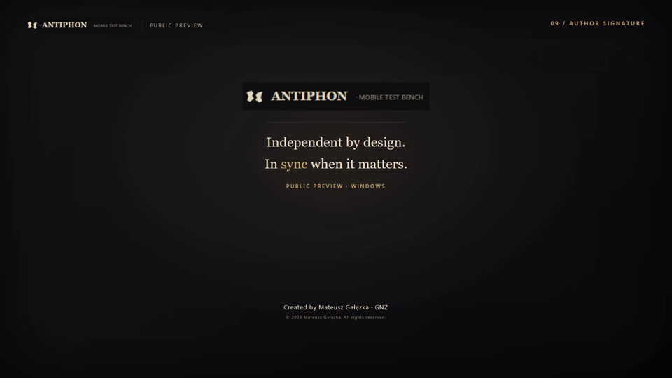

# ANTIPHON — MOBILE TEST BENCH

**Independent by design. In sync when it matters.**

Antiphon is an independently built Windows desktop application for real-device Android test automation. It is created and maintained by one developer, Mateusz Gałązka (GNZ).

The name comes from the Ancient Greek **ἀντίφωνος · antíphōnos** — “sounding in response.” Independent devices, coordinated execution.

## What it does

- **Editable YAML test scenarios** — create, validate, save and queue repeatable test definitions.
- **Browsing and Streaming workflows** — run bounded browsing sequences or launch approved streaming content on a device.
- **Coordinated MO/MT CALL** — one shared call across two explicitly assigned phones, with MO and MT roles.
- **M1/M2 Device Lanes** — independent per-device queues with a shared CALL rendezvous.
- **Classic Night Run** — ordered, sequential repetition with explicit iteration and deadline policies.
- **Safe Pause / Resume / STOP** — wait for a safe device boundary, verify the same physical device on resume, and keep STOP dominant.
- **Results, timelines and logs** — inspect persisted execution evidence, attempts, cleanup state and local diagnostics.
- **Five editable starter templates** — Browsing, Streaming, Universal CALL, Data Connectivity and Network Toggle.

## Free Public Preview limits

- Maximum **two distinct physical devices** per session (M1 and M2).
- Maximum **two hours of active Night Run execution** per session. Paused time is excluded.
- Unlimited separate sessions, with **no subscription, trial countdown, license key or activation**.
- The compiled Public Preview channel enforces the limits. Developer settings cannot remove them.
- Device Lanes is limited to verified M1/M2. M3/M4 Device Lanes, Network Recovery, Reboot Recovery and unqualified Device Lanes operations are not part of the preview.
- CALL KPI values remain unavailable; no modem values are fabricated.

## Download

The Windows x64 installer and its SHA-256 checksum are attached to the GitHub Release for **v0.1.0-preview**. This repository intentionally does not commit the installer binary.

- Installer: `Antiphon-PublicPreview-0.1.0-preview-x64-Setup.exe`
- Checksums: [checksums/SHA256SUMS.txt](checksums/SHA256SUMS.txt)
- User manual: [docs/Antiphon_Public_Preview_User_Manual.pdf](docs/Antiphon_Public_Preview_User_Manual.pdf)
- Release notes: [RELEASE_NOTES.md](RELEASE_NOTES.md)

The installer is currently **unsigned**. Windows SmartScreen may show a warning. Verify the published SHA-256 before installing; do not disable Windows security protections.

## Requirements

- **Windows x64** with a desktop supported by .NET 10 and WPF.
- **Android Platform Tools / ADB** — not bundled. Install it separately and make it available to Antiphon.
- A compatible **USB driver** for the target Android device.
- Android devices with developer options and USB debugging enabled, unlocked and authorized.
- Authorized SIMs, phone numbers, accounts, URLs and network environments for your testcases.

The Windows build is self-contained and includes its .NET runtime. **Linux is in development** and is not available in this release.

## Installation

1. Download the installer from the GitHub Release and verify its SHA-256.
2. Run the per-user installer. It installs under `%LOCALAPPDATA%\Programs\Antiphon Public Preview`.
3. Keep or choose the Scripts directory. Existing user-edited YAML files are never overwritten; starters are created only when missing.
4. Launch Antiphon from the Start Menu, complete First Run setup, and verify the channel and version in **Settings → About**.
5. Install and point Antiphon at Android Platform Tools/ADB if it is not already detected.

Settings, scripts, Results and logs remain outside the application directory and are preserved by upgrade and uninstall.

## Privacy

The application does not include telemetry, analytics or advertising, does not require an account and does not automatically upload local settings, scripts, Results or diagnostics. Execution evidence stays local. Testcases can contact third-party websites or streaming services according to their own terms and privacy policies. Review local evidence for device identifiers, numbers, URLs and paths before sharing it.

## Documentation and notices

- [User manual](docs/Antiphon_Public_Preview_User_Manual.pdf)
- [Preview Terms](docs/PREVIEW_TERMS.md) — version 0.1.0
- [Third-party notices](THIRD_PARTY_NOTICES.md)
- [License](LICENSE.md)

The public repository is a **distribution repository**, not the application source repository. Application source code and internal development history are not published.

## Media

The approved 1080p promotional video is attached to the GitHub Release for v0.1.0-preview. It is not committed to this repository. The image above is a preview thumbnail.

## Feedback

Use the GitHub issue tracker or email **galaz92@gmail.com** with the build/channel, exact action and sanitized evidence. Do not include real phone numbers, credentials or private device data.

---

**Created by Mateusz Gałązka · GNZ**  
© 2026 Mateusz Gałązka. All rights reserved.
